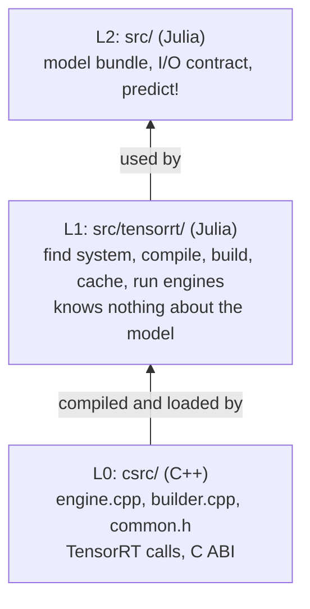
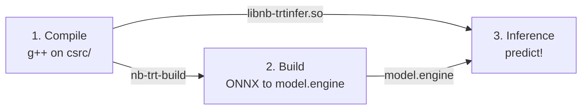
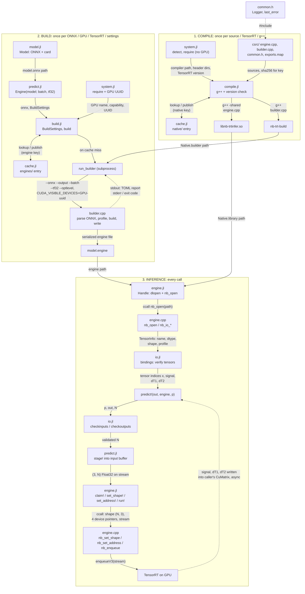

# NeuralBloch: how the TensorRT engine is compiled, built and run

NeuralBloch turns a hash-pinned ONNX model into a TensorRT engine on the user's machine, then runs it on GPU arrays.

## Overview

### Layers

### Phases

| | 1. Compile | 2. Build | 3. Inference |
|---|---|---|---|
| Runs | once per C++ source, TensorRT version and g++ | once per ONNX, GPU model, TensorRT version, settings and C++ source | every `predict!` call |
| Entry point | `compile(sys)` | `build(onnx)` | `Handle(path)`, `predict!` |
| Input | `csrc/*`, g++, TensorRT headers | ONNX, GPU, `BuildSettings`, `nb-trt-build` | `model.engine`, `libnb-trtinfer.so`, GPU arrays |
| Output | `libnb-trtinfer.so`, `nb-trt-build` | `model.engine` | signal, ∂T₁, ∂T₂ |
| Cache | `native/` | `engines/` | none |
| Runs as | `g++` subprocess | `nb-trt-build` subprocess | `ccall` into a shared library, in the Julia process |
| Error | `CompileError` (g++ failed), `PrerequisiteError` (header and library versions differ) | `BuildError` | `TensorRTError` |

Both caches live under `cache_root()`; deleting it is always safe, entries are rebuilt on demand.

## Files by phase

Only the files that take part in a phase are listed.

### Module files (all phases)

| File | Role |
|---|---|
| `src/tensorrt/TensorRT.jl` | Defines the L1 module; includes `system`, `cache`, `compile`, `build`, `engine` in dependency order. |
| `src/NeuralBloch.jl` | Defines the top-level module; includes `tensorrt/TensorRT.jl`, `model.jl`, `io.jl`, `predict.jl`; sets the public API. |

### 1. Compile

Goal: turn `csrc/` into the two native products.

| File | Role |
|---|---|
| `src/tensorrt/system.jl` | `detect()` finds `libnvinfer`, `libnvonnxparser`, the TensorRT and CUDA headers, g++ and the GPU. `require(sys; gpu = false)` throws a `PrerequisiteError` with install hints if anything but the GPU is missing. |
| `src/tensorrt/compile.jl` | `compile()` runs g++ on both sources, then checks header against library versions with `nb-trt-build --version`. |
| `src/tensorrt/cache.jl` | `native/` entries: hashed key, per-entry lock, temp directory, atomic publish. |
| `csrc/builder.cpp` | Compiled into the `nb-trt-build` executable. |
| `csrc/engine.cpp` | Compiled into `libnb-trtinfer.so`. |
| `csrc/common.h` | Included by both: `nb::Logger`, `last_error`, `nb::fail`, `NB_API`, version helpers. |
| `csrc/exports.map` | Linker version script: only `nb_*` symbols are exported. |
| `src/predict.jl` | `Engine()` triggers it through `detect` and `compile`. |

### 2. Build

Goal: turn the ONNX into a serialized `model.engine` for this GPU.

| File | Role |
|---|---|
| `src/model.jl` | `Model()` checks `card.toml`, the ONNX sha256 pin and the RF tables; supplies the ONNX path. |
| `src/predict.jl` | `Engine(model; batch, tf32)` creates the `BuildSettings` and calls `build`. |
| `src/tensorrt/system.jl` | `require(sys)` also checks the GPU; supplies name, capability and UUID for the engine key and `CUDA_VISIBLE_DEVICES`. |
| `src/tensorrt/build.jl` | `BuildSettings`, `build()`, and `run_builder` (subprocess, watchdog, exit-code messages, `BuildError`). Before the subprocess starts, `build` returns CUDA.jl's pooled memory to the driver. |
| `src/tensorrt/compile.jl` | Supplies `Native.builder`, the executable `run_builder` runs. |
| `src/tensorrt/cache.jl` | `engines/` entries: `engine_key`, `getorbuild`, manifest and size checks. |
| `csrc/builder.cpp` | Runs as `nb-trt-build`: parses the ONNX, applies TF32, optimization level and batch profile, builds and writes `model.engine`, prints a TOML report, exits with code 1–7. |
| `csrc/common.h` | Logger sends TensorRT errors to stderr, which becomes the `BuildError` message. |

### 3. Inference

Goal: open the engine once, then run it for every call.

**Opening the engine (once per `Engine`)**

| File | Role |
|---|---|
| `src/tensorrt/compile.jl` | Supplies `Native.library`, which `Handle` loads. |
| `src/tensorrt/engine.jl` | `Handle` loads `libnb-trtinfer.so` with `dlopen` and `dlsym`, calls `nb_open`, and reads `TensorInfo` (name, dtype, shape, profile). |
| `csrc/engine.cpp` | `nb_open` deserializes the engine and creates the execution context; `nb_io_*` describe the tensors. |
| `src/io.jl` | `bindings` checks the engine's tensors against the contract and returns the tensor indices, or a `BundleError`. |
| `src/predict.jl` | `Engine()` allocates the `(3, max)` input buffer and stores the indices and `sys.gpu.name`. |

**Every call (`predict!`)**

| File | Role |
|---|---|
| `src/io.jl` | `checkinputs`, `checkoutputs`, `batch_problem`, plus alignment and overlap checks, all before anything is queued. Also the ASCII/Unicode name mapping (`dT1` and `∂T₁`). |
| `src/predict.jl` | `predict!`, `predict` and `outputs`. `stage!` copies `T₁`, `T₂`, `B₁` into the input buffer. The sink buffer takes derivatives that were not requested. `checkdomain` and `close` are also here. |
| `src/model.jl` | Holds `ntr`, the training domain and the sequence metadata; `ntr`, `domain` and `sequence` in `predict.jl` read them. |
| `src/tensorrt/engine.jl` | `claim!` orders streams, `set_shape!` checks the profile, `set_address!` binds device pointers, `run!` enqueues the run. `close` and the finalizer free the handle. |
| `csrc/engine.cpp` | `nb_set_shape`, `nb_set_address`, `nb_enqueue` (`enqueueV3` on the CUDA stream), `nb_close`. |
| `csrc/common.h` | Logger fills `last_error`, which `nb_last_error()` returns to Julia. |

## Detailed flow

Solid arrows carry data or calls; dotted arrows carry results, reports or includes. `nb-trt-build` feeds the build phase and `libnb-trtinfer.so` feeds inference. `model.engine` is only loaded in inference, never rebuilt there.
